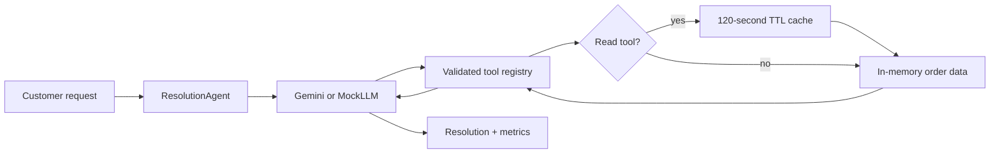

# Order Resolution Agent

An autonomous, guardrailed customer-resolution agent built with Google Gemini function calling. It investigates an order, checks replacement stock, chooses a safe exchange or refund outcome, notifies the customer, and returns a concise resolution.

The project runs fully offline with a deterministic `MockLLM`; Gemini is used automatically when `GEMINI_API_KEY` is configured.

## Highlights

- **Safe autonomous workflow** — lookup → inventory → exchange/refund → notification.
- **Gemini manual function calling** — model turns and tool responses preserve the required protocol ordering.
- **Strong guardrails** — whitelist-only tools, schema validation, retry handling, and iteration-based escalation.
- **Production-minded optimization** — compact prompts, payload pruning, read caching, and parallel read-tool execution.
- **Measurable behavior** — per-run metrics plus a reproducible offline benchmark.

## Quick start

```bash
git clone <your-repo-url>
cd order-resolution-agent

python -m venv venv
# Windows
venv\Scripts\activate
# macOS / Linux: source venv/bin/activate

pip install -r requirements.txt
copy .env.example .env  # macOS / Linux: cp .env.example .env
```

Add your key to `.env` only when you want live Gemini calls:

```env
GEMINI_API_KEY=your_key_here
```

```bash
python main.py --demo --mock  # offline demo
python main.py --demo         # Gemini when a key is available; mock otherwise
python main.py                # interactive session
python -m pytest -q           # offline test suite
python benchmark.py           # optimization benchmark
```

## Resolution workflow



| Step | Tool | Outcome |
|---|---|---|
| 1 | `lookup_order` | Finds the order and eligibility facts. |
| 2 | `check_inventory` | Determines whether a replacement exists. |
| 3 | `confirm_exchange` or `process_refund` | Performs the appropriate, mutually exclusive resolution. |
| 4 | `send_notification` | Sends one confirmation after a successful resolution. |

If an order is missing, the agent asks the customer to verify it. If the model loops or the service stays unavailable, the session is escalated rather than continuing indefinitely.

## AI optimization

| Technique | Implementation | Safety boundary |
|---|---|---|
| Prompt and schema compaction | Concise system guidance and tool declarations. | Required arguments and validation remain unchanged. |
| Payload pruning | Removes safe empty/noise fields and limits oversized text while preserving `false`, `0`, protocol fields, and meaningful results. | Never removes required Gemini function-call metadata. |
| Parallel tools | Uses ordered parallel execution only for a batch of independent read-only calls. | Refunds, exchanges, and notifications always stay sequential. |
| In-memory cache | Bounded, single-flight TTL cache for order and inventory reads. | Writes, failed calls, credentials, and shared sensitive values are never cached. |

### Metrics

Every `AgentResult` exposes `metrics`; demo and interactive modes print them as JSON. Available measurements include request payload bytes, Gemini usage metadata, cache hits/misses, cache latency, tool counts/errors, parallel/sequential timings, API-call count, and end-to-end latency.

Provider token values are populated only when Gemini returns usage metadata; unavailable values are intentionally reported as `null` / N/A rather than estimated. `benchmark.py` uses a clearly labelled 40 ms controlled delay to compare sequential and parallel read execution; cache data is measured from the real process cache.

## Configuration

Copy [.env.example](.env.example) and adjust as needed.

| Variable | Default | Purpose |
|---|---:|---|
| `GEMINI_MODEL` | `gemini-2.5-flash` | Gemini model used for live requests. |
| `AI_OPTIMIZATION_ENABLED` | `true` | Master optimization switch. |
| `PROMPT_COMPACTION_ENABLED` | `true` | Enables compact prompt behavior. |
| `PAYLOAD_PRUNING_ENABLED` | `true` | Enables outbound payload pruning. |
| `PARALLEL_TOOL_CALLING` | `true` | Allows eligible read batches to run concurrently. |
| `CACHE_TTL_SECONDS` | `120` | Lifetime of cached read results. |
| `CACHE_MAX_ENTRIES` | `500` | Maximum process-local cache entries. |
| `MAX_HISTORY_MESSAGES` | `6` | Conversation-context budget. |
| `TOOL_TIMEOUT_MS` | `10000` | Reserved timeout setting for external tool integrations. |

## Project layout

```text
agent.py          ReAct loop, metrics, and parallel-call coordination
llm.py            Gemini and offline LLM adapters
schemas.py        Shared Gemini declarations and argument schemas
registry.py       Whitelist dispatch, validation, and read-cache integration
optimization.py   Configuration, pruning, TTL cache, and metrics
tools.py          Resolution tool implementations
database.py       Synthetic in-memory data store
benchmark.py      Reproducible optimization benchmark
tests/            Offline behavioral tests
```

## Quality checks

```bash
python -m pytest -q
python -m compileall -q .
python benchmark.py
```

The tests cover core resolution behavior, safe dispatch, invalid arguments, tool failures, refund/exchange constraints, notification flow, and escalation behavior. See [OPTIMIZATION_REPORT.md](OPTIMIZATION_REPORT.md) for implementation detail and measured benchmark guidance.

## Security and production notes

- Keep `GEMINI_API_KEY` in `.env`; never commit it.
- The included database is synthetic and intended only for local demonstration.
- The default cache is process-local. Replace it with Redis or another shared store for multiple application instances.
- Model-triggered writes remain intentionally serialized. Extend tools with authorization and audit controls before using real financial or customer systems.
