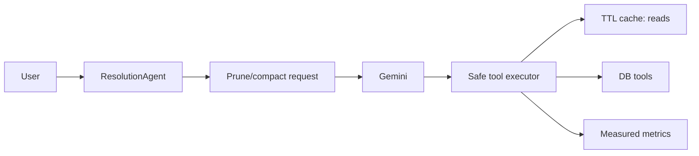

# Order Resolution Agent

Autonomous ReAct agent (Gemini function calling) that checks orders and inventory, then exchanges or refunds with safe tool dispatch and guardrails.

The agent is an LLM tool-calling loop (ReAct style) using **Google Gemini**
(new `google-genai` SDK, automatic function calling disabled). It
investigates damaged/broken orders on its own and autonomously decides
between a replacement exchange and a refund, then notifies the customer.

A deterministic rule-based `MockLLM` provides the same interface and the
same tool-call sequence, so the whole demo and suite run **fully offline**.

## Quick start

```bash
git clone <your-repo-url>
cd order-resolution-agent

python -m venv venv
source venv/bin/activate          # Windows: venv\Scripts\activate

pip install -r requirements.txt

cp .env.example .env              # Windows: copy .env.example .env
# then edit .env and paste your real GEMINI_API_KEY

python main.py --demo             # 5 scenarios (Gemini if key present, else mock)
python main.py --demo --mock      # force offline mock mode
pytest -q                         # full offline test suite
```

`GEMINI_API_KEY` is read from `.env` (loaded via python-dotenv); the model
name defaults to `gemini-2.5-flash` (`GEMINI_MODEL`). Without a key the
agent falls back to the offline `MockLLM` automatically.

## Security

- `.env` holds your real API key and is excluded via `.gitignore`.
- **Never commit `.env`** - verify with `git status` before pushing; it must
  not appear, while `.env.example` (the safe template) stays in the repo.
- Report issues without reproducing them on real orders: the mock DB is
  synthetic.

## Architecture

```
                      +-----------------------------+
                      |           main.py           |
                      |  CLI: --demo / interactive  |
                      |  picks GeminiLLM or MockLLM |
                      +-------------+---------------+
                                    |
                        user message (scenario / prompt)
                                    v
                      +-----------------------------+
                      |          agent.py           |
                      |   ResolutionAgent.run()     |
                      |  ReAct loop + guardrails    |
                      |                             |
                      |  contents history:          |
                      |   user -> model(Fc) ->      |
                      |   user(FR) -> model -> ...  |
                      +------+---------------+------+
                             |               |
              generate()     |               |  dispatch()
              (Thought)      v               v  (Action/Observation)
        +-------------+            +---------------------+
        |   llm.py    |            |     registry.py     |
        | GeminiLLM   |            | TOOL_REGISTRY       |
        | MockLLM     |            | whitelist + safe    |
        | (same       |            | dispatcher:         |
        |  interface) |            | UNAUTHORIZED_TOOL / |
        +------+------+            | INVALID_ARGUMENTS / |
               |                   | TOOL_EXECUTION_ERROR|
               | model calls       +----------+----------+
               v                              |
     +--------------------+        schemas.py | build_gemini_tools()
     |    Google Gemini    |        (dict schemas = single source of truth,
     | gemini-2.5-flash    |         also converted to types.FunctionDeclaration)
     | function calling    |
     | AFC disabled        |
     +--------------------+                   |
                                  +----------------------+
                                  |       tools.py       |
                                  | lookup_order         |
                                  | check_inventory      |
                                  | process_refund       |
                                  | confirm_exchange     |
                                  | send_notification    |
                                  +----------+-----------+
                                             |
                                  +----------+-----------+
                                  |      database.py     |
                                  | in-memory orders /   |
                                  | inventory / refunds /|
                                  | exchanges / notes    |
                                  +----------------------+
```

## Run modes

```bash
python main.py                    # interactive prompt
python main.py --mock             # force offline mock
python main.py --max-iterations 3 # custom guardrail
```

Demo scenarios: (1) damaged item in stock -> exchange, (2) damaged item,
stock 0 -> refund, (3) final-sale order -> refund, (4) unknown order ->
graceful not-found, no refund, (5) runaway model loop -> iteration cap ->
human escalation.

## Steps 1-5 mapped to files

| Step | Requirement | File |
|------|-------------|------|
| 1 | 5 deterministic tools that return status dicts and never raise | `tools.py`, seed data in `database.py` |
| 2 | One declarative schema per tool + `build_gemini_tools()` for `types.FunctionDeclaration` | `schemas.py` |
| 3 | Whitelist registry and safe dispatcher (unauthorized tools, arg validation, execution-error wrapping) | `registry.py` |
| 4 | ReAct loop, manual function calling, full-turn history append (thought signatures preserved), provider-agnostic `LLMResponse` interface | `agent.py`, `llm.py` |
| 5 | `MAX_ITERATIONS` + escalation, tool-error feedback, malformed-arg self-correction, 429/503 retry (1s, 3s) then escalate | `agent.py`, `llm.py`, `main.py` |

## Example output (`python main.py --demo --mock`, abridged)

```
# Scenario 1/5: Damaged item, replacement in stock -> exchange

User: Hi, my order ORD-1001 arrived with a cracked screen on the laptop. It's damaged, what can you do?

--- Iteration 1 --------------------------------------------------
[Thought]   I need the details of ORD-1001 before acting.
[Action]      lookup_order(order_id='ORD-1001')
[Observation] {'status': 'success', 'order_id': 'ORD-1001', 'customer_name': 'Ana Silva', ...}

--- Iteration 2 --------------------------------------------------
[Action]      check_inventory(item_id='ITEM-LAPTOP-15')
[Observation] {'status': 'success', 'item_id': 'ITEM-LAPTOP-15', 'stock_count': 4, 'available': True}

--- Iteration 3 --------------------------------------------------
[Action]      confirm_exchange(order_id='ORD-1001')
[Observation] {'status': 'success', 'order_id': 'ORD-1001', 'exchange_reference': 'EXG-09C2D4', 'remaining_stock': 3}

--- Iteration 4 --------------------------------------------------
[Action]      send_notification(customer_email='ana.silva@example.com', message='Dear Ana Silva, ...')
[Observation] {'status': 'success', 'notification_id': 'NTF-1B7E52', 'delivered': True}

--- Iteration 5 --------------------------------------------------
[Response]  Hi Ana Silva! Your exchange for order ORD-1001 is confirmed under
reference EXG-09C2D4 (remaining stock: 3). A confirmation email has been sent
to ana.silva@example.com. Anything else I can help with?

Final answer : Hi Ana Silva! Your exchange for order ORD-1001 is confirmed ...
Escalated    : False
Model calls  : 5
Tools called : lookup_order -> check_inventory -> confirm_exchange -> send_notification
DB side effects:
  refund(s): REF-LEGACY42
  exchange(s): EXG-09C2D4
  notification(s): NTF-1B7E52 -> ana.silva@example.com
```

## Design notes

## AI optimization

The agent keeps its existing Gemini/manual-tool architecture while adding four
measured optimizations: compact instructions and declarations, schema-aware
payload pruning, ordered parallel execution of independent read-only calls,
and a bounded 120-second process-local TTL cache. Mutating tools are never
cached or parallelized. Cache keys include the operation and validated args;
multi-tenant integrations should also pass a tenant identifier. The in-memory
cache is per process, so use Redis for multi-instance deployments.



Configure `.env` with `AI_OPTIMIZATION_ENABLED`, `PROMPT_COMPACTION_ENABLED`,
`PAYLOAD_PRUNING_ENABLED`, `PARALLEL_TOOL_CALLING`, `CACHE_TTL_SECONDS` (120),
`CACHE_MAX_ENTRIES`, `MAX_HISTORY_MESSAGES`, and `TOOL_TIMEOUT_MS`.

Run the reproducible offline benchmark with `python benchmark.py`; its tool
latency is explicitly simulated, while cache counts and payload sizes are
actual process measurements. Gemini token/output usage appears only when the
provider returns usage metadata; unavailable values remain `N/A`.

- **Tools are the only mutation point** for the mock DB; every tool returns
  `{"status": "success"|"error", ...}` and never raises, so the loop always
  has an observation to feed back.
- **Schemas are defined once** as plain dicts and shared by the Gemini tool
  declarations and the dispatcher's argument validation - no drift.
- **Gemini history discipline**: the full model turn (candidate content,
  thought signatures included) is appended unchanged; all function calls are
  executed and answered with a single user-role content whose parts are in
  the same order as the calls (linked by name since Gemini supplies no IDs).
- **Guardrails**: `MAX_ITERATIONS` (counts model calls; happy path = 5, cap
  default 6) triggers `escalated=True` with "Flagged for human escalation"
  logged via `logging`; LLM 429/5xx failures are retried twice (1s, 3s) and
  then escalated - the loop never crashes.
